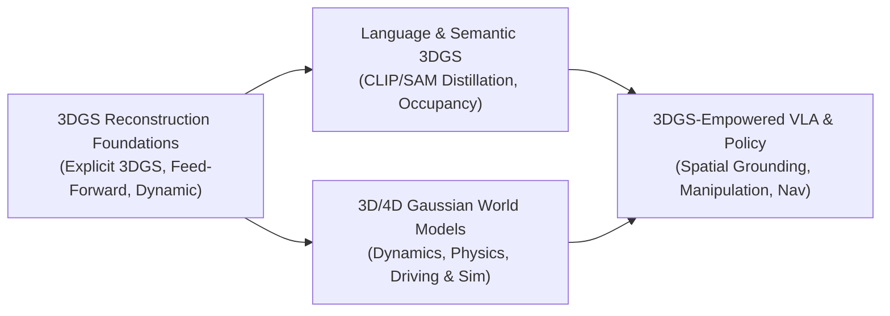

<div align="center">

# A Survey on 3D Gaussian Splatting for Vision-Language-Action and World Models: Reconstruction, Semantics, and Embodied Simulation

[](https://awesome.re)
[](#%EF%B8%8F-data--synchronization)
[](#%F0%9F%93%9A-overview)

</div>

## 📚 Overview

This repository maintains a structured literature catalog and quantitative benchmark tracker at the intersection of **3D/4D Gaussian Splatting (3DGS)**, **Vision-Language-Action (VLA) models**, and **World Models** across embodied manipulation, navigation, and autonomous driving.



## 🧭 Navigation

- **[Taxonomy Overview](#%EF%B8%8F-taxonomy-of-3dgs-for-vla--world-models)**
- **[Paper List (By Year)](#-3dgs-vla--world-model-paper-list)**
  <br>&nbsp;&nbsp;&nbsp;&nbsp;[2024](#2024) | [2023](#2023)
- **[Performance Comparison](#-3dgs-vla--world-model-performance-comparison)**
  <br>&nbsp;&nbsp;&nbsp;&nbsp;[Waymo-NOTR Dynamic Scenes](#performance-comparisons-on-waymo-notr-dynamic-urban-scenes) | [RealEstate10K & ACID Feed-Forward](#performance-comparisons-on-realestate10k-and-acid-feed-forward-3dgs) | [LERF Open-Vocabulary 3D](#performance-comparisons-on-lerf-open-vocabulary-3d-understanding) | [RLBench Multi-Task Manipulation](#performance-comparisons-on-rlbench-multi-task-manipulation)
- **[Citations](#citations)** | **[Contributing](#contributing)**

## 📢 News

- ✅ **2026-11-18**: Initial baseline release covering **2023–2024** foundational papers (28 papers) with machine-validated `data/catalog.json`, provenance documentation in `data/SOURCES.md`, and deterministic README table rendering via `scripts/sync_catalog.py`.

## 🗂️ Taxonomy of 3DGS for VLA & World Models

| Pillar | Core Focus | Representative Works |
| --- | --- | --- |
| **1. 3DGS for VLA & Embodied Manipulation / Navigation** | Spatial grounding for VLA, open-vocabulary grasping, editable manipulation, safe navigation | 3D-VLA, GraspSplats, Splat-MOVER, GaussianGrasper, Splat-Nav, GNFactor |
| **2. 3D/4D Gaussian World Models & Neural Simulators** | Action-conditioned dynamics, physics-grounded 3DGS, driving 4DGS & world-model reconstruction | ManiGaussian, ReconDreamer, Street Gaussians, DrivingGaussian, PVG, PhysGaussian |
| **3. Language-Grounded & Semantic 3DGS** | Open-vocabulary 3D language fields, point-level grounding, 3D occupancy | LangSplat, LEGaussians, Feature 3DGS, Gaussian Grouping, OpenGaussian, GaussianFormer, LERF |
| **4. Generalizable, Feed-Forward & Generative 3DGS** | Sparse-view feed-forward 3DGS, dynamic 3D/4DGS foundations | MVSplat, pixelSplat, latentSplat, LGM, 3DGS, Deformable 3DGS, Dynamic 3DGS, 4DGS |
| **5. Surveys & Taxonomies** | Comprehensive reviews across 3DGS in robotics | 3DGS in Robotics (2024) |

## 📖 3DGS-VLA & World Model Paper List

### 2024
| Paper | Venue | Link | Code |
|-------|--------|------|------|
| ReconDreamer: Crafting World Models for Driving Scene Reconstruction via Online Restoration<br><sub>Chaojun Ni, Guosheng Zhao, Xiaofeng Wang, Zheng Zhu, Wenkang Qin, Guan Huang, Chen Liu, Yuyin Chen, Yida Wang, Xueyang Zhang, Yifei Zhan, Kun Zhan, Peng Jia, Xianpeng Lang, Xingang Wang, Wenjun Mei</sub> | arXiv 2024 | [Paper](https://arxiv.org/abs/2411.19548) | [Code](https://github.com/GigaAI-research/ReconDreamer) |
| 3D Gaussian Splatting in Robotics: A Survey<br><sub>Siting Zhu, Guangming Wang, Xin Kong, Dezhi Kong, Hesheng Wang</sub> | arXiv 2024 | [Paper](https://arxiv.org/abs/2410.12262) | [Code](https://github.com/zstsandy/Awesome-3D-Gaussian-Splatting-in-Robotics) |
| GraspSplats: Efficient Manipulation with 3D Feature Splatting<br><sub>Mazeyu Ji, Ri-Zhao Qiu, Xueyan Zou, Xiaolong Wang</sub> | CoRL 2024 | [Paper](https://arxiv.org/abs/2409.02084) | [Code](https://github.com/jimazeyu/GraspSplats) |
| OpenGaussian: Towards Point-Level 3D Gaussian-based Open Vocabulary Understanding<br><sub>Yanmin Wu, Jiarui Meng, Haijie Li, Chenming Wu, Yahao Shi, Xinhua Cheng, Chen Zhao, Haocheng Feng, Errui Ding, Jingdong Wang, Jian Zhang</sub> | NeurIPS 2024 | [Paper](https://arxiv.org/abs/2406.02058) | [Code](https://github.com/OpenGaussian/OpenGaussian) |
| GaussianFormer: Scene as Gaussians for Vision-Based 3D Semantic Occupancy Prediction<br><sub>Yuanhui Huang, Wenzhao Zheng, Yunpeng Zhang, Jie Zhou, Jiwen Lu</sub> | ECCV 2024 | [Paper](https://arxiv.org/abs/2405.17429) | [Code](https://github.com/huang-yh/GaussianFormer) |
| Splat-MOVER: Multi-Stage, Open-Vocabulary Robotic Manipulation via Editable Gaussian Splatting<br><sub>Ola Shorinwa, Johnathan Tucker, Aliyah Smith, Aiden Swann, Timothy Chen, Roya Firoozi, Monroe Kennedy III, Mac Schwager</sub> | arXiv 2024 | [Paper](https://arxiv.org/abs/2405.04378) | [Code](https://splatmover.github.io/) |
| latentSplat: Autoencoding Variational Gaussians for Fast Generalizable 3D Reconstruction<br><sub>Christopher Wewer, Kevin Raj, Eddy Ilg, Bernt Schiele, Jan Eric Lenssen</sub> | ECCV 2024 | [Paper](https://arxiv.org/abs/2403.16292) | [Code](https://github.com/geometric-rl/latentsplat) |
| MVSplat: Efficient 3D Gaussian Splatting from Sparse Multi-View Images<br><sub>Yuedong Chen, Haofei Xu, Chuanxia Zheng, Bohan Zhuang, Marc Pollefeys, Andreas Geiger, Tat-Jen Cham, Jianfei Cai</sub> | ECCV 2024 (Oral) | [Paper](https://arxiv.org/abs/2403.14627) | [Code](https://github.com/donydchen/mvsplat) |
| GaussianGrasper: 3D Language Gaussian Splatting for Open-vocabulary Robotic Grasping<br><sub>Yuhang Zheng, Xiangyu Chen, Yupeng Zheng, Songen Gu, Runyi Yang, Bu Jin, Pengfei Li, Chengliang Zhong, Zengmao Wang, Lina Liu, Chao Yang, Dawei Wang, Xiaoxiao Long, Meiqing Wang</sub> | IEEE RA-L 2024 | [Paper](https://arxiv.org/abs/2403.09637) | [Code](https://github.com/MrSecant/GaussianGrasper) |
| 3D-VLA: A 3D Vision-Language-Action Generative World Model<br><sub>Haoyu Zhen, et al.</sub> | ICML 2024 | [Paper](https://arxiv.org/abs/2403.09631) | [Code](https://github.com/UMass-Embodied-AGI/3D-VLA) |
| ManiGaussian: Dynamic Gaussian Splatting for Multi-task Robotic Manipulation<br><sub>Guanxing Lu, et al.</sub> | ECCV 2024 | [Paper](https://arxiv.org/abs/2403.08321) | [Code](https://github.com/guanxinglu/ManiGaussian) |
| Splat-Nav: Safe Real-Time Robot Navigation in Gaussian Splatting Maps<br><sub>Timothy Chen, Ola Shorinwa, Joseph Bruno, Javier Yu, Weijia Zeng, Aiden Swann, Keiko Nagami, Philip Dames, Mac Schwager</sub> | IEEE T-RO | [Paper](https://arxiv.org/abs/2403.02751) | [Code](https://github.com/chengine/splatnav) |
| LGM: Large Multi-View Gaussian Model for High-Resolution 3D Content Creation<br><sub>Jiaxiang Tang, Zhaoxi Chen, Xiaokang Chen, Tengfei Wang, Gang Zeng, Ziwei Liu</sub> | ECCV 2024 | [Paper](https://arxiv.org/abs/2402.05054) | [Code](https://github.com/3DTopia/LGM) |
| Street Gaussians: Modeling Dynamic Urban Scenes with Gaussian Splatting<br><sub>Yunzhi Yan, Haotong Lin, Chenxu Zhou, Weijie Wang, Haiyang Sun, Kun Zhan, Xianpeng Lang, Xiaowei Zhou, Sida Peng</sub> | ECCV 2024 | [Paper](https://arxiv.org/abs/2401.01339) | [Code](https://github.com/zju3dv/street_gaussians) |
| LangSplat: 3D Language Gaussian Splatting<br><sub>Minghan Qin, Wanhua Li, Jiawei Zhou, Haoqian Wang, Hanspeter Pfister</sub> | CVPR 2024 | [Paper](https://arxiv.org/abs/2312.16084) | [Code](https://github.com/minghanqin/LangSplat) |
| pixelSplat: 3D Gaussian Splats from Image Pairs for Scalable Generalizable 3D Reconstruction<br><sub>David Charatan, Sizhe Li, Andrea Tagliasacchi, Vincent Sitzmann</sub> | CVPR 2024 (Oral) | [Paper](https://arxiv.org/abs/2312.12337) | [Code](https://github.com/dcharatan/pixelsplat) |
| DrivingGaussian: Composite Gaussian Splatting for Surrounding Dynamic Autonomous Driving Scenes<br><sub>Xiaoyu Zhou, Zhiwei Lin, Xiaojun Shan, Yongtao Wang, Deqing Sun, Ming-Hsuan Yang</sub> | CVPR 2024 | [Paper](https://arxiv.org/abs/2312.07920) | [Code](https://github.com/VDIGPKU/DrivingGaussian) |
| Feature 3DGS: Supercharging 3D Gaussian Splatting to Enable Distilled Feature Fields<br><sub>Shijie Zhou, Haoran Chang, Sicheng Jiang, Zhiwen Fan, Zehao Zhu, Dejia Xu, Pradyumna Chari, Suya You, Zhangyang Wang, Achuta Kadambi</sub> | CVPR 2024 (Highlight) | [Paper](https://arxiv.org/abs/2312.03203) | [Code](https://github.com/ShijieZhou-UCLA/feature-3dgs) |
| Gaussian Grouping: Segment and Edit Anything in 3D Scenes<br><sub>Mingqiao Ye, Martin Danelljan, Fisher Yu, Lei Ke</sub> | ECCV 2024 | [Paper](https://arxiv.org/abs/2312.00732) | [Code](https://github.com/gaussian-grouping/gaussian-grouping) |
| Periodic Vibration Gaussian: Dynamic Urban Scene Reconstruction and Real-time Rendering<br><sub>Zeyu Yang, Hongye Yang, Zhenqi Fu, et al.</sub> | CVPR 2024 | [Paper](https://arxiv.org/abs/2311.18561) | [Code](https://github.com/ZeyuYang/PVG) |
| LEGaussians: Language Embedded 3D Gaussians for Open-Vocabulary Scene Understanding<br><sub>Jin-Chuan Shi, Miao Wang, Hao-Bin Duan, Shao-Hua Guan</sub> | CVPR 2024 | [Paper](https://arxiv.org/abs/2311.18482) | [Code](https://github.com/buaavrcg/LEGaussians) |
| PhysGaussian: Physics-Integrated 3D Gaussians for Generative Dynamics<br><sub>Tianyi Xie, Zeshun Zong, Yuxing Qiu, Xuan Li, Yutao Feng, Yin Yang, Chenfanfu Jiang</sub> | CVPR 2024 (Highlight) | [Paper](https://arxiv.org/abs/2311.12198) | [Code](https://github.com/XPandora/PhysGaussian) |
| 4D Gaussian Splatting for Real-Time Dynamic Scene Rendering<br><sub>Guanjun Wu, Taoran Yi, Jiemin Fang, Lingxi Xie, Xiaopeng Zhang, Wei Wei, Wenyu Liu, Qi Tian, Xinggang Wang</sub> | CVPR 2024 |  | [Code](https://github.com/hustvl/4DGaussians) |
| Deformable 3D Gaussians for High-Fidelity Monocular Dynamic Scene Reconstruction<br><sub>Ziyi Yang, Xinyu Gao, Wen Zhou, Shaohui Jiao, Yuqing Zhang, Xiaogang Jin</sub> | CVPR 2024 | [Paper](https://arxiv.org/abs/2309.13101) | [Code](https://github.com/ingra14m/Deformable-3D-Gaussians) |
| Dynamic 3D Gaussians: Tracking by Persistent Dynamic View Synthesis<br><sub>Jonathon Luiten, et al.</sub> | 3DV 2024 | [Paper](https://arxiv.org/abs/2308.09713) | [Code](https://github.com/JonathonLuiten/Dynamic3DGaussians) |

### 2023
| Paper | Venue | Link | Code |
|-------|--------|------|------|
| GNFactor: Multi-Task Real Robot Learning with Generalizable Neural Feature Fields<br><sub>Yanjie Ze, Ge Yan, Yueh-Hua Wu, Annabella Macaluso, Yuying Ge, Jianglong Ye, Nicklas Hansen, Li Erran Li, Xiaolong Wang</sub> | CoRL 2023 (Oral) | [Paper](https://arxiv.org/abs/2308.16891) | [Code](https://github.com/YanjieZe/GNFactor) |
| 3D Gaussian Splatting for Real-Time Radiance Field Rendering<br><sub>Bernhard Kerbl, Georgios Kopanas, Thomas Leimkühler, George Drettakis</sub> | ACM TOG (SIGGRAPH 2023) | [Paper](https://arxiv.org/abs/2308.04079) | [Code](https://github.com/graphdeco-inria/gaussian-splatting) |
| LERF: Language Embedded Radiance Fields<br><sub>Max Kerr, et al.</sub> | ICCV 2023 | [Paper](https://arxiv.org/abs/2303.09553) | [Code](https://github.com/kerrj/lerf) |

## 📊 3DGS-VLA & World Model Performance Comparison

### Performance Comparisons on Waymo-NOTR Dynamic Urban Scenes

Metrics are **PSNR (↑) / SSIM (↑) / LPIPS (↓)** for full scenes and **PSNR* (↑) / SSIM* (↑)** for dynamic objects.


#### Scene Reconstruction

| Method | Venue & Year | Full (PSNR / SSIM / LPIPS) | Dynamic* (PSNR* / SSIM*) | Notes |
| --- | --- | --- | --- | --- |
| 3DGS | ACM TOG (SIGGRAPH 2023) | 28.47/0.876/0.136 | 23.26/0.716 | Explicit anisotropic 3D Gaussians baseline |
| MARS | CICAI 2023 | 28.24/0.866/0.252 | 23.37/0.701 | Instance-aware modular NeRF simulator |
| EmerNeRF | ICLR 2024 | 28.16/0.806/0.228 | 24.32/0.682 | Emergent static-dynamic spatial-temporal decomposition |

#### Novel View Synthesis (NVS)

| Method | Venue & Year | Full (PSNR / SSIM / LPIPS) | Dynamic* (PSNR* / SSIM*) | Notes |
| --- | --- | --- | --- | --- |
| 3DGS | ACM TOG (SIGGRAPH 2023) | 25.14/0.813/0.165 | 20.48/0.753 | Explicit anisotropic 3D Gaussians baseline |
| MARS | CICAI 2023 | 26.61/0.796/0.305 | 22.21/0.697 | Instance-aware modular NeRF simulator |
| EmerNeRF | ICLR 2024 | 25.14/0.747/0.313 | 23.49/0.660 | Emergent static-dynamic spatial-temporal decomposition |


### Performance Comparisons on RealEstate10K and ACID Feed-Forward 3DGS

Two-view feed-forward 3DGS evaluation on RealEstate10K and zero-shot cross-dataset generalization on ACID. Metrics are **PSNR (↑) / SSIM (↑) / LPIPS (↓)**.

| Method | Venue & Year | RealEstate10K (PSNR / SSIM / LPIPS) | ACID Zero-Shot (PSNR / SSIM / LPIPS) | Approach |
| --- | --- | --- | --- | --- |
| pixelSplat | CVPR 2024 (Oral) | 25.89/0.858/0.142 | 27.64/0.830/0.160 | Epipolar attention + probabilistic depth sampling |
| MVSplat | ECCV 2024 (Oral) | 26.39/0.869/0.128 | 28.15/0.841/0.147 | Multi-view cost volume + cross-view attention |


### Performance Comparisons on LERF Open-Vocabulary 3D Understanding

Open-vocabulary 3D understanding on the LERF dataset across *Ramen*, *Figurines*, *Teatime*, and *Waldo Kitchen*. Higher is better (↑).


#### Localization Accuracy (%) — LangSplat Table 1 Protocol

| Method | Venue & Year | Metric | Ramen | Figurines | Teatime | Waldo Kitchen | Overall |
| --- | --- | --- | --- | --- | --- | --- | --- |
| LSeg | ICLR 2022 | Loc Acc (%) | 7.0 | 7.6 | 21.7 | 29.9 | 16.6 |
| LERF | ICCV 2023 | Loc Acc (%) | 28.2 | 38.6 | 45.0 | 37.9 | 37.4 |
| LangSplat | CVPR 2024 | Loc Acc (%) | 51.2 | 44.7 | 65.1 | 44.5 | 51.4 |


### Performance Comparisons on RLBench Multi-Task Manipulation

Evaluated across 10 multi-task language-conditioned RLBench tasks (166 variations). Metric is **Average Success Rate (%) ↑**.

| Category | Method | Venue & Year | Avg. Success Rate (%) ↑ | Approach |
| --- | --- | --- | --- | --- |
| Voxel-based | PerAct | CoRL 2022 | 18.0 | Voxelized 3D Perceiver IO behavior cloning |
| NeRF-based | GNFactor | CoRL 2023 (Oral) | 28.3 | Generalizable neural feature fields for robotic manipulation |
| Dynamic 3DGS + World Model | ManiGaussian | ECCV 2024 | 44.8 | Dynamic Gaussian Splatting + Gaussian World Model future prediction |


## 🛠️ Data & Synchronization

Benchmark tables in `README.md` are automatically generated from [`data/catalog.json`](data/catalog.json). Provenance and protocol isolation rules are documented in [`data/SOURCES.md`](data/SOURCES.md).

```sh
python3 scripts/sync_catalog.py --import-papers
python3 scripts/sync_catalog.py --check
```

## Citations

If this curated survey repository helps your research, please cite the original papers listed in the tables above.

## Contributing

Contributions are welcome! To add a new paper or verified benchmark entry:
1. Add the paper to the corresponding year table in `README.md` (`Paper<br><sub>Authors</sub> | Venue | Link | Code`).
2. Add verified benchmark metrics (with `source`, `sourceLabel`, `note`, and `paperTitle`) in `data/catalog.json` and document the table provenance in `data/SOURCES.md`.
3. Run `python3 scripts/sync_catalog.py --import-papers` and `python3 scripts/sync_catalog.py --check` before opening a pull request.
