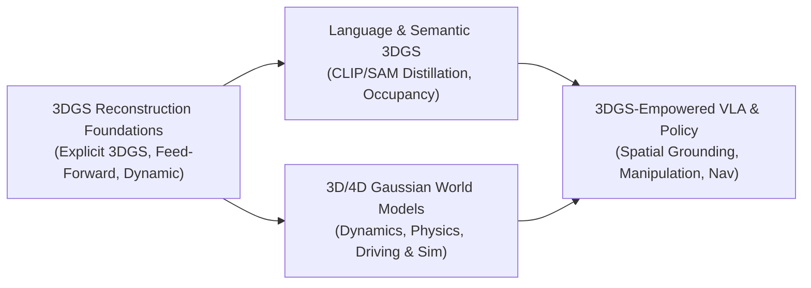

<div align="center">

# A Survey on 3D Gaussian Splatting for Vision-Language-Action and World Models: Reconstruction, Semantics, and Embodied Simulation

[](https://awesome.re)
[](#%EF%B8%8F-data--synchronization)
[](#%F0%9F%93%9A-overview)

</div>

## 📚 Overview

This repository maintains a structured literature catalog and quantitative benchmark tracker at the intersection of **3D/4D Gaussian Splatting (3DGS)**, **Vision-Language-Action (VLA) models**, and **World Models** across embodied manipulation, navigation, and autonomous driving.



## 🧭 Navigation

- **[Taxonomy Overview](#%EF%B8%8F-taxonomy-of-3dgs-for-vla--world-models)**
- **[Paper List (By Year)](#-3dgs-vla--world-model-paper-list)**
  <br>&nbsp;&nbsp;&nbsp;&nbsp;[2026](#2026) | [2025](#2025) | [2024](#2024) | [2023](#2023)
- **[Performance Comparison](#-3dgs-vla--world-model-performance-comparison)**
  <br>&nbsp;&nbsp;&nbsp;&nbsp;[Waymo-NOTR Dynamic Scenes](#performance-comparisons-on-waymo-notr-dynamic-urban-scenes) | [Waymo Novel Trajectory Synthesis](#performance-comparisons-on-waymo-novel-trajectory-synthesis) | [RealEstate10K & ACID Feed-Forward](#performance-comparisons-on-realestate10k-and-acid-feed-forward-3dgs) | [LERF Open-Vocabulary 3D](#performance-comparisons-on-lerf-open-vocabulary-3d-understanding) | [RLBench Multi-Task Manipulation](#performance-comparisons-on-rlbench-multi-task-manipulation)
- **[Citations](#citations)** | **[Contributing](#contributing)**

## 📢 News

- ✅ **2026-11-18**: Initial baseline release covering **2023–2024** foundational papers (28 papers) with machine-validated `data/catalog.json`, provenance documentation in `data/SOURCES.md`, and deterministic README table rendering via `scripts/sync_catalog.py`.
- ✅ **2026-11-18 (update)**: Added **2025** coverage (14 papers) on 3DGS-empowered VLA & manipulation, Gaussian world models, and feed-forward 3D reconstruction / visual geometry.
- ✅ **2026-11-21**: Expanded **2025** to 55 papers and added a new **2026** section (28 papers), covering Gaussian world models for manipulation, Gaussian maps for navigation / VLN, real-to-sim-to-real data engines, and CCF-A conference / journal work (CVPR, ICCV, NeurIPS, ICLR, AAAI, IJCAI, ACM MM, TPAMI, T-RO, IJCV, IJRR).

## 🗂️ Taxonomy of 3DGS for VLA & World Models

| Pillar | Core Focus | Representative Works |
| --- | --- | --- |
| **1. 3DGS for VLA & Embodied Manipulation / Navigation** | Spatial grounding for VLA, open-vocabulary grasping, Gaussian maps for navigation & VLN, safe planning | 3D-VLA, GraspSplats, GaussianGrasper, Splat-Nav, GNFactor, GWM (2025), ManiGaussian++ (2025), VLA-AN (2025), M3 (2025), GaussNav (2025), g3D-LF (2025), 3D Gaussian Map for VLN (2025), GeoPredict (2026), GST-VLA (2026), EmbodiedSplat (2026), ReLaGS (2026), GLMap (2026) |
| **2. 3D/4D Gaussian World Models & Neural Simulators** | Action-conditioned dynamics, physics-grounded 3DGS, driving 4DGS, real-to-sim-to-real data engines | ManiGaussian, ReconDreamer, Street Gaussians, DrivingGaussian, PVG, PhysGaussian, TesserAct (2025), ReconDreamer++ (2025), OmniRe (2025), GigaWorld-0 (2025), DreMa (2025), EnerVerse (2025), GaussianWorld (2025), PartRM (2025), Self-Correcting via GS Foresight (2025), NGFF (2026), WorldSplat (2026), Video2Robo (2026) |
| **3. Language-Grounded & Semantic 3DGS** | Open-vocabulary 3D language fields, point-level grounding, 3D occupancy | LangSplat, LEGaussians, Feature 3DGS, Gaussian Grouping, OpenGaussian, GaussianFormer, LERF, LangSplatV2 (2025), FMGS (2025), UniGS (2025), ReasonGrounder (2025), GEAL (2025), EmbodiedOcc++ (2025), TGSFormer (2026) |
| **4. Generalizable, Feed-Forward & Generative 3DGS** | Sparse-view feed-forward 3DGS, dynamic 3D/4DGS foundations, controllable driving scene generation | MVSplat, pixelSplat, latentSplat, LGM, 3DGS, Deformable 3DGS, 4DGS, VGGT (2025), π³ (2025), DepthSplat (2025), AnySplat (2025), NoPoSplat (2025), DrivingForward (2025), GGS (2025), DrivingRecon (2025), VR-Drive (2025), HDGS (2026) |
| **5. Surveys & Taxonomies** | Comprehensive reviews across 3DGS in robotics, SLAM, world models | 3DGS in Robotics (2024), A Step Toward World Models (2025), Neural Fields & 3DGS in Robotics (2026), NeRF/3DGS for SLAM (2026), 3DGS Applications Survey (2026), World Action Models (2026) |

## 📖 3DGS-VLA & World Model Paper List

### 2026
| Paper | Venue | Link | Code |
|-------|--------|------|------|
| Robot-Aligned 3D Gaussian Splatting for Precise Reaching with Wrist-Camera VLA Policies<br><sub>Zuoxu Wang, Xiao Liang</sub> | arXiv 2026 | [Paper](https://arxiv.org/abs/2610.35626) | [Code](https://001-wang.github.io/PrecisionReach-GS/) |
| Embodied Multimodal Grounding for Open-Vocabulary Mobile Manipulation via Semantic 3D Gaussian Splatting<br><sub>Huosen Ou, Dongni Song, Yuncong Wang, Tao Zhou, Yiding Ji</sub> | ACM MM 2026 | [Paper](https://arxiv.org/abs/2608.10756) | [Code](https://github.com/taozh2017/AM2ES) |
| ManiSplat: Manipulation Trajectory Synthesis from Monocular Video via Decoupled 3D Gaussian Splatting<br><sub>Wenhao Hu, Haonan Zhou, Liu Liu, Yun Du, Xinjie Wang, Ziang Li, et al.</sub> | IJCAI 2026 | [Paper](https://arxiv.org/abs/2606.10645) |  |
| Video2Robo: 3DGS-based Synthetic Data from One Video Enables Scalable Robot Learning<br><sub>Yinan Deng, Kejia Hu, Ye Chen, Jianyu Dou, Jiahui Wang, Jingyu Zhao, et al.</sub> | CVPR 2026 | [Paper](https://openaccess.thecvf.com/content/CVPR2026/html/Deng_Video2Robo_3DGS-based_Synthetic_Data_from_One_Video_Enables_Scalable_Robot_CVPR_2026_paper.html) |  |
| Uncertainty-Aware Gaussian Map for Vision-Language Navigation<br><sub>Jianzhe Gao, Rui Liu, Yuxuan Xu, Tongtong Cao, Yingxue Zhang, Zhanguang Zhang, et al.</sub> | ICLR 2026 | [Paper](https://arxiv.org/abs/2605.26503) |  |
| World Action Models: The Next Frontier in Embodied AI<br><sub>Siyin Wang, Junhao Shi, Zhaoyang Fu, Xinzhe He, Feihong Liu, Chenchen Yang, Yikang Zhou, Zhaoye Fei, Jingjing Gong, Jinlan Fu, Mike Zheng Shou, Xuanjing Huang, Xipeng Qiu, Yu-Gang Jiang</sub> | arXiv 2026 | [Paper](https://arxiv.org/abs/2605.12090) | [Code](https://github.com/openmoss/Awesome-WAM) |
| Embody4D: A Generalist Data Engine for Embodied 4D World Modeling<br><sub>Peiyan Tu, Hanxin Zhu, Jingwen Sun, Shaojie Ren, Cong Wang, Yuyan Xu, Jiayi Luo, Xiaoqian Cheng, et al.</sub> | arXiv 2026 | [Paper](https://arxiv.org/abs/2605.01799) | [Code](https://github.com/peiyantu/Embody4D) |
| Multi-Scale Gaussian-Language Map for Zero-shot Embodied Navigation and Reasoning<br><sub>Sixian Zhang, Yiyao Wang, Xinhang Song, Keming Zhang, Zijian Xu, Shuqiang Jiang</sub> | CVPR 2026 | [Paper](https://arxiv.org/abs/2605.01736) | [Code](https://github.com/sx-zhang/GLMap) |
| DLWM: Dual Latent World Models enable Holistic Gaussian-centric Pre-training in Autonomous Driving<br><sub>Yiyao Zhu, Ying Xue, Haiming Zhang, Guangfeng Jiang, Wending Zhou, Xu Yan, et al.</sub> | CVPR 2026 | [Paper](https://arxiv.org/abs/2604.00969) |  |
| ReLaGS: Relational Language Gaussian Splatting<br><sub>Yaxu Xie, Abdalla Arafa, Alireza Javanmardi, Christen Millerdurai, Jia Cheng Hu, Shaoxiang Wang, et al.</sub> | CVPR 2026 | [Paper](https://arxiv.org/abs/2603.17605) | [Code](https://github.com/dfki-av/ReLaGS) |
| GST-VLA: Structured Gaussian Spatial Tokens for 3D Depth-Aware Vision-Language-Action Models<br><sub>Md Selim Sarowar, Omer Tariq, Sungho Kim</sub> | arXiv 2026 | [Paper](https://arxiv.org/abs/2603.09079) |  |
| EmbodiedSplat: Online Feed-Forward Semantic 3DGS for Open-Vocabulary 3D Scene Understanding<br><sub>Seungjun Lee, Zihan Wang, Yunsong Wang, Gim Hee Lee</sub> | CVPR 2026 | [Paper](https://arxiv.org/abs/2603.04254) | [Code](https://github.com/0nandon/EmbodiedSplat) |
| Zero-Shot Robotic Manipulation via 3D Gaussian Splatting-Enhanced Multimodal Retrieval-Augmented Generation<br><sub>Zhipeng Xie, Jian Gong, Xinfeng Tan, Zhibin Zhang, Yuan Xie</sub> | arXiv 2026 | [Paper](https://arxiv.org/abs/2603.00500) |  |
| FlowHOI: Flow-based Semantics-Grounded Generation of Hand-Object Interactions for Dexterous Robot Manipulation<br><sub>Huajian Zeng, Lingyun Chen, Jiaqi Yang, Yuantai Zhang, Fan Shi, Peidong Liu, Xingxing Zuo</sub> | arXiv 2026 | [Paper](https://arxiv.org/abs/2602.13444) |  |
| Learning Physics-Grounded 4D Dynamics with Neural Gaussian Force Fields<br><sub>Shiqian Li, Ruihong Shen, Junfeng Ni, Chang Pan, Chi Zhang, Yixin Zhu</sub> | ICLR 2026 | [Paper](https://arxiv.org/abs/2602.00148) |  |
| HDGS: Hierarchical Dynamic Gaussian Splatting for Urban Driving Scenes<br><sub>Fudong Ge, Jin Gao, Hanshi Wang, Yiwei Zhang, Ke Wang, Weiming Hu, et al.</sub> | AAAI 2026 | [Paper](https://doi.org/10.1609/aaai.v40i6.42419) |  |
| A Hierarchical Onboard Vision-Language-Navigation Framework for Aerial Robots in Complex Environments<br><sub>Yuze Wu, Mo Zhu, Xingxing Li, Yuheng Du, Zhaoqi Wang, Yuxin Fan, et al.</sub> | IEEE T-RO 2026 | [Paper](https://doi.org/10.1109/TRO.2026.3754505) |  |
| GeoPredict: Leveraging Predictive Kinematics and 3D Gaussian Geometry for Precise VLA Manipulation<br><sub>Jingjing Qian, Boyao Han, Chen Shi, Lei Xiao, Long Yang, Shaoshuai Shi, et al.</sub> | CVPR 2026 | [Paper](https://arxiv.org/abs/2512.16811) |  |
| TGSFormer: Scalable Temporal Gaussian Splatting for Embodied Semantic Scene Completion<br><sub>Rui Qian, Haozhi Cao, Tianchen Deng, Tianxin Hu, Weixiang Guo, Shenghai Yuan, et al.</sub> | CVPR 2026 | [Paper](https://arxiv.org/abs/2512.00300) |  |
| PhysGS: Bayesian-Inferred Gaussian Splatting for Physical Property Estimation<br><sub>Samarth Chopra, Jing Liang, Gershom Seneviratne, Dinesh Manocha</sub> | CVPR 2026 | [Paper](https://arxiv.org/abs/2511.18570) |  |
| GSWorld: Closed-Loop Photo-Realistic Simulation Suite for Robotic Manipulation<br><sub>Guangqi Jiang, Haoran Chang, Ri-Zhao Qiu, Yutong Liang, Mazeyu Ji, Jiyue Zhu, Zhao Dong, Xueyan Zou, Xiaolong Wang</sub> | ICRA 2026 | [Paper](https://arxiv.org/abs/2510.20813) | [Code](https://github.com/luccachiang/GSWorld) |
| WorldSplat: Gaussian-Centric Feed-Forward 4D Scene Generation for Autonomous Driving<br><sub>Ziyue Zhu, Zhanqian Wu, Zhenxin Zhu, Lijun Zhou, Haiyang Sun, Bing Wang, et al.</sub> | ICLR 2026 | [Paper](https://arxiv.org/abs/2509.23402) | [Code](https://github.com/xiaomi-research/worldsplat) |
| A Survey on 3D Gaussian Splatting Applications: Segmentation, Editing, and Generation<br><sub>Shuting He, Peilin Ji, Yitong Yang, Changshuo Wang, Jiayi Ji, Yinglin Wang, et al.</sub> | IEEE TPAMI 2026 | [Paper](https://arxiv.org/abs/2508.09977) |  |
| From Seeing to Experiencing: Scaling Navigation Foundation Models with Reinforcement Learning<br><sub>Honglin He, Yukai Ma, Brad Squicciarini, Wayne Wu, Bolei Zhou</sub> | ICLR 2026 | [Paper](https://arxiv.org/abs/2507.22028) | [Code](https://github.com/VAIL-UCLA/S2E) |
| GAF: Gaussian Action Field as a 4D Representation for Dynamic World Modeling in Robotic Manipulation<br><sub>Ying Chai, Litao Deng, Ruizhi Shao, Jiajun Zhang, Kangchen Lv, Liangjun Xing, Xiang Li, Hongwen Zhang, Yebin Liu</sub> | ICRA 2026 | [Paper](https://arxiv.org/abs/2506.14135) | [Code](https://github.com/chaiying1/GAF) |
| Learning high-fidelity robot self-model with articulated 3D Gaussian splatting<br><sub>Kejun Hu, Peng Yu, Ning Tan</sub> | IJRR 2026 | [Paper](https://arxiv.org/abs/2503.05398) |  |
| Neural Fields and 3D Gaussian Splatting in Robotics: A Survey<br><sub>Muhammad Zubair Irshad, Mauro Comi, Yen-Chen Lin, Nick Heppert, Abhinav Valada, Rares Ambrus, et al.</sub> | IEEE T-RO 2026 | [Paper](https://arxiv.org/abs/2410.20220) |  |
| How NeRFs and 3-D Gaussian Splatting Are Reshaping SLAM: A Survey<br><sub>Fabio Tosi, Youmin Zhang, Ziren Gong, Erik Sandström, Stefano Mattoccia, Martin R. Oswald, et al.</sub> | IEEE T-RO 2026 | [Paper](https://arxiv.org/abs/2402.13255) |  |

### 2025
| Paper | Venue | Link | Code |
|-------|--------|------|------|
| VLA-AN: An Efficient and Onboard Vision-Language-Action Framework for Aerial Navigation in Complex Environments<br><sub>Yuze Wu, Mo Zhu, Xingxing Li, Yuheng Du, Yuxin Fan, Wenjun Li, Zhichao Han, Xin Zhou, Fei Gao</sub> | arXiv 2025 | [Paper](https://arxiv.org/abs/2512.15258) |  |
| GigaWorld-0: World Models as Data Engine to Empower Embodied AI<br><sub>GigaWorld Team, Angen Ye, Boyuan Wang, Chaojun Ni, Guan Huang, Guosheng Zhao, et al.</sub> | arXiv 2025 | [Paper](https://arxiv.org/abs/2511.19861) | [Code](https://giga-world-0.github.io/) |
| A Step Toward World Models: A Survey on Robotic Manipulation<br><sub>Peng-Fei Zhang, Yi Cheng, Heng Shen, et al.</sub> | arXiv 2025 | [Paper](https://arxiv.org/abs/2511.02097) |  |
| GauDP: Reinventing Multi-Agent Collaboration through Gaussian-Image Synergy in Diffusion Policies<br><sub>Ziye Wang, Li Kang, Yiran Qin, Jiahua Ma, Zhanglin Peng, Lei Bai, et al.</sub> | NeurIPS 2025 | [Paper](https://arxiv.org/abs/2511.00998) | [Code](https://ziyeeee.github.io/gaudp.io) |
| VR-Drive: Viewpoint-Robust End-to-End Driving with Feed-Forward 3D Gaussian Splatting<br><sub>Hoonhee Cho, Jae-Young Kang, Giwon Lee, Hyemin Yang, Heejun Park, Seokwoo Jung, et al.</sub> | NeurIPS 2025 | [Paper](https://arxiv.org/abs/2510.23205) | [Code](https://github.com/mickeykang16/VR-Drive) |
| 3D Gaussian Map with Open-Set Semantic Grouping for Vision-Language Navigation<br><sub>Jianzhe Gao, Rui Liu, Wenguan Wang</sub> | ICCV 2025 | [Paper](https://arxiv.org/abs/2605.26500) |  |
| EmbodiedSplat: Personalized Real-to-Sim-to-Real Navigation with Gaussian Splats from a Mobile Device<br><sub>Gunjan Chhablani, Xiaomeng Ye, Muhammad Zubair Irshad, Zsolt Kira</sub> | ICCV 2025 | [Paper](https://arxiv.org/abs/2509.17430) |  |
| RealMirror: A Comprehensive, Open-Source Vision-Language-Action Platform for Embodied AI<br><sub>Cong Tai, Zhaoyu Zheng, Haixu Long, Hansheng Wu, Haodong Xiang, Zhengbin Long, Jun Xiong, Rong Shi, et al.</sub> | arXiv 2025 | [Paper](https://arxiv.org/abs/2509.14687) | [Code](https://terminators2025.github.io/RealMirror.github.io) |
| FastVGGT: Training-Free Acceleration of Visual Geometry Transformer<br><sub>You Shen, Zhipeng Zhang, Yansong Qu, Xiawu Zheng, Jiayi Ji, Shengchuan Zhang, Liujuan Cao</sub> | arXiv 2025 | [Paper](https://arxiv.org/abs/2509.02560) | [Code](https://mystorm16.github.io/fastvggt/) |
| DrivingGaussian++: Towards Realistic Reconstruction and Controllable Editing for Surrounding Dynamic Autonomous Driving Scenes<br><sub>Yajiao Xiong, et al.</sub> | arXiv 2025 | [Paper](https://arxiv.org/abs/2508.20965) | [Code](https://github.com/vdigpku/DrivingGaussian_plus) |
| GWM: Towards Scalable Gaussian World Models for Robotic Manipulation<br><sub>Guanxing Lu, Baoxiong Jia, Puhao Li, Yixin Chen, Ziwei Wang, Yansong Tang, Siyuan Huang</sub> | ICCV 2025 | [Paper](https://arxiv.org/abs/2508.17600) | [Code](https://gaussian-world-model.github.io/) |
| IGL-Nav: Incremental 3D Gaussian Localization for Image-goal Navigation<br><sub>Wenxuan Guo, Xiuwei Xu, Hang Yin, Ziwei Wang, Jianjiang Feng, Jie Zhou, et al.</sub> | ICCV 2025 | [Paper](https://arxiv.org/abs/2508.00823) |  |
| π³: Permutation-Equivariant Visual Geometry Learning<br><sub>Yifan Wang, Jianjun Zhou, Haoyi Zhu, Wenzheng Chang, Yang Zhou, Zizun Li, Junyi Chen, Jiangmiao Pang, Chunhua Shen, Tong He</sub> | arXiv 2025 | [Paper](https://arxiv.org/abs/2507.13347) | [Code](https://github.com/yyfz/Pi3) |
| LangSplatV2: High-dimensional 3D Language Gaussian Splatting with 450+ FPS<br><sub>Wanhua Li, Yujie Zhao, Minghan Qin, Yang Liu, Yuanhao Cai, Chuang Gan, Hanspeter Pfister</sub> | NeurIPS 2025 | [Paper](https://arxiv.org/abs/2507.07136) | [Code](https://langsplat-v2.github.io) |
| Spatial-Temporal Aware Visuomotor Diffusion Policy Learning<br><sub>Zhenyang Liu, et al.</sub> | ICCV 2025 | [Paper](https://arxiv.org/abs/2507.06710) |  |
| RoboPearls: Editable Video Simulation for Robot Manipulation<br><sub>Tao Tang, Likui Zhang, Youpeng Wen, Kaidong Zhang, Jia-Wang Bian, Xia Zhou, et al.</sub> | ICCV 2025 | [Paper](https://arxiv.org/abs/2506.22756) |  |
| ManiGaussian++: General Robotic Bimanual Manipulation with Hierarchical Gaussian World Model<br><sub>Tengbo Yu, Guanxing Lu, Zaijia Yang, Haoyuan Deng, Season Si Chen, Jiwen Lu, Wenbo Ding, Guoqiang Hu, Yansong Tang, Ziwei Wang</sub> | IROS 2025 | [Paper](https://arxiv.org/abs/2506.19842) | [Code](https://github.com/yangzaijia/ManiGaussian_Bimanual) |
| HoliGS: Holistic Gaussian Splatting for Embodied View Synthesis<br><sub>Xiaoyuan Wang, Yizhou Zhao, Botao Ye, Xiaojun Shan, Weijie Lyu, Lu Qi, et al.</sub> | NeurIPS 2025 | [Paper](https://arxiv.org/abs/2506.19291) |  |
| Chain of Semantics Programming in 3D Gaussian Splatting Representation for 3D Vision Grounding<br><sub>Jiaxin Shi, Mingyue Xiang, Hao Sun, Yixuan Huang, Zhi Weng</sub> | CVPR 2025 | [Paper](https://doi.org/10.1109/CVPR52734.2025.02287) |  |
| AnySplat: Feed-forward 3D Gaussian Splatting from Unconstrained Views<br><sub>Lihan Jiang, Yucheng Mao, Linning Xu, Tao Lu, Kerui Ren, Yichen Jin, Xudong Xu, Mulin Yu, et al.</sub> | SIGGRAPH Asia 2025 (ACM TOG) | [Paper](https://arxiv.org/abs/2505.23716) | [Code](https://github.com/OpenRobotLab/AnySplat) |
| TesserAct: Learning 4D Embodied World Models<br><sub>Haoyu Zhen, Qiao Sun, Hongxin Zhang, Junyan Li, Siyuan Zhou, Yilun Du, Chuang Gan</sub> | arXiv 2025 | [Paper](https://arxiv.org/abs/2504.20995) | [Code](https://github.com/UMass-Embodied-AGI/TesserAct) |
| DRAWER: Digital Reconstruction and Articulation With Environment Realism<br><sub>Hongchi Xia, Entong Su, Marius Memmel, Arhan Jain, Raymond Yu, Numfor Mbiziwo-Tiapo, et al.</sub> | CVPR 2025 | [Paper](https://arxiv.org/abs/2504.15278) |  |
| EmbodiedOcc++: Boosting Embodied 3D Occupancy Prediction with Plane Regularization and Uncertainty Sampler<br><sub>Hao Wang, Xiaobao Wei, Xiaoan Zhang, Jianing Li, Chengyu Bai, Ying Li, et al.</sub> | ACM MM 2025 | [Paper](https://arxiv.org/abs/2504.09540) | [Code](https://github.com/PKUHaoWang/EmbodiedOcc2) |
| ReasonGrounder: LVLM-Guided Hierarchical Feature Splatting for Open-Vocabulary 3D Visual Grounding and Reasoning<br><sub>Zhenyang Liu, Yikai Wang, Sixiao Zheng, Tongying Pan, Longfei Liang, Yanwei Fu, et al.</sub> | CVPR 2025 | [Paper](https://arxiv.org/abs/2503.23297) |  |
| PartRM: Modeling Part-Level Dynamics with Large Cross-State Reconstruction Model<br><sub>Mingju Gao, Yike Pan, Huan-ang Gao, Zongzheng Zhang, Wenyi Li, Hao Dong, et al.</sub> | CVPR 2025 | [Paper](https://arxiv.org/abs/2503.19913) | [Code](https://github.com/GasaiYU/PartRM) |
| ReconDreamer++: Harmonizing Generative and Reconstructive Models for Driving Scene Representation<br><sub>Guosheng Zhao, Xiaofeng Wang, Chaojun Ni, Zheng Zhu, Wenkang Qin, Guan Huang, Xingang Wang</sub> | arXiv 2025 | [Paper](https://arxiv.org/abs/2503.18438) | [Code](https://recondreamer-plus.github.io/) |
| M3: 3D-Spatial MultiModal Memory<br><sub>Xueyan Zou, Yuchen Song, Ri-Zhao Qiu, Xuanbin Peng, Jianglong Ye, Sifei Liu, et al.</sub> | ICLR 2025 | [Paper](https://arxiv.org/abs/2503.16413) |  |
| VGGT: Visual Geometry Grounded Transformer<br><sub>Jianyuan Wang, Minghao Chen, Nikita Karaev, Andrea Vedaldi, Christian Rupprecht, David Novotny</sub> | CVPR 2025 | [Paper](https://arxiv.org/abs/2503.11651) | [Code](https://github.com/facebookresearch/vggt) |
| UniGS: Unified Language-Image-3D Pretraining with Gaussian Splatting<br><sub>Haoyuan Li, Yanpeng Zhou, Tao Tang, Jifei Song, Yihan Zeng, Michael Kampffmeyer, et al.</sub> | ICLR 2025 | [Paper](https://arxiv.org/abs/2502.17860) |  |
| Self-Correcting Robot Manipulation via Gaussian-Splatted Foresight<br><sub>Shaohui Pan, Yong Xu, Ruotao Xu, Zihan Zhou, Si Wu, Zhuliang Yu</sub> | AAAI 2025 | [Paper](https://doi.org/10.1609/aaai.v39i25.34866) |  |
| ActiveGAMER: Active GAussian Mapping through Efficient Rendering<br><sub>Liyan Chen, Huangying Zhan, Kevin Chen, Xiangyu Xu, Qingan Yan, Changjiang Cai, et al.</sub> | CVPR 2025 | [Paper](https://arxiv.org/abs/2501.06897) | [Code](https://github.com/oppo-us-research/ActiveGAMER) |
| Vid2Sim: Realistic and Interactive Simulation from Video for Urban Navigation<br><sub>Ziyang Xie, Zhizheng Liu, Zhenghao Peng, Wayne Wu, Bolei Zhou</sub> | CVPR 2025 | [Paper](https://arxiv.org/abs/2501.06693) |  |
| EnerVerse: Envisioning Embodied Future Space for Robotics Manipulation<br><sub>Siyuan Huang, Liliang Chen, Pengfei Zhou, Shengcong Chen, Yue Liao, Zhengkai Jiang, et al.</sub> | NeurIPS 2025 | [Paper](https://arxiv.org/abs/2501.01895) |  |
| Dream to Manipulate: Compositional World Models Empowering Robot Imitation Learning with Imagination<br><sub>Leonardo Barcellona, Andrii Zadaianchuk, Davide Allegro, Samuele Papa, Stefano Ghidoni, Efstratios Gavves</sub> | ICLR 2025 | [Paper](https://arxiv.org/abs/2412.14957) |  |
| GaussianWorld: Gaussian World Model for Streaming 3D Occupancy Prediction<br><sub>Sicheng Zuo, Wenzhao Zheng, Yuanhui Huang, Jie Zhou, Jiwen Lu</sub> | CVPR 2025 | [Paper](https://arxiv.org/abs/2412.10373) | [Code](https://github.com/zuosc19/GaussianWorld) |
| GEAL: Generalizable 3D Affordance Learning with Cross-Modal Consistency<br><sub>Dongyue Lu, Lingdong Kong, Tianxin Huang, Gim Hee Lee</sub> | CVPR 2025 | [Paper](https://arxiv.org/abs/2412.09511) |  |
| DrivingRecon: Large 4D Gaussian Reconstruction Model For Autonomous Driving<br><sub>Hao Lu, Tianshuo Xu, Wenzhao Zheng, Yunpeng Zhang, Wei Zhan, Dalong Du, et al.</sub> | NeurIPS 2025 | [Paper](https://arxiv.org/abs/2412.09043) |  |
| UniScene: Unified Occupancy-centric Driving Scene Generation<br><sub>Bohan Li, Jiazhe Guo, Hongsi Liu, Yingshuang Zou, Yikang Ding, Xiwu Chen, Hu Zhu, Feiyang Tan, Chi Zhang, Tiancai Wang, et al.</sub> | CVPR 2025 | [Paper](https://arxiv.org/abs/2412.05435) | [Code](https://github.com/Arlo0o/UniScene-Unified-Occupancy-centric-Driving-Scene-Generation) |
| 6DOPE-GS: Online 6D Object Pose Estimation using Gaussian Splatting<br><sub>Yufeng Jin, Vignesh Prasad, Snehal Jauhri, et al.</sub> | ICCV 2025 | [Paper](https://arxiv.org/abs/2412.01543) |  |
| g3D-LF: Generalizable 3D-Language Feature Fields for Embodied Tasks<br><sub>Zihan Wang, Gim Hee Lee</sub> | CVPR 2025 | [Paper](https://arxiv.org/abs/2411.17030) | [Code](https://github.com/MrZihan/g3D-LF) |
| NoPoSplat: No Pose, No Problem: Surprisingly Simple 3D Gaussian Splats from Sparse Unposed Images<br><sub>Botao Ye, Sifei Liu, Haofei Xu, Xueting Li, Marc Pollefeys, Ming-Hsuan Yang, Songyou Peng</sub> | ICLR 2025 (Oral) | [Paper](https://arxiv.org/abs/2410.24207) | [Code](https://github.com/cvg/NoPoSplat) |
| Multimodal LLM Guided Exploration and Active Mapping using Fisher Information<br><sub>Wen Jiang, Boshu Lei, Katrina Ashton, Kostas Daniilidis</sub> | ICCV 2025 | [Paper](https://arxiv.org/abs/2410.17422) |  |
| MagicDrive3D: Controllable 3D Generation for Any-View Rendering in Street Scenes<br><sub>Ruiyuan Gao, Kai Chen, Zhihao Li, Lanqing Hong, Zhenguo Li, Qiang Xu</sub> | CVPR 2025 | [Paper](https://arxiv.org/abs/2410.14723) | [Code](https://github.com/flymin/magicdrive3d) |
| DepthSplat: Connecting Gaussian Splatting and Depth<br><sub>Haofei Xu, Songyou Peng, Fangjinhua Wang, Hermann Blum, Daniel Barath, Andreas Geiger, Marc Pollefeys</sub> | CVPR 2025 | [Paper](https://arxiv.org/abs/2410.13862) | [Code](https://github.com/cvg/depthsplat) |
| DriveDreamer4D: World Models Are Effective Data Machines for 4D Driving Scene Representation<br><sub>Guosheng Zhao, Chaojun Ni, Xiaofeng Wang, Zheng Zhu, Xueyang Zhang, Yida Wang, Guan Huang, Xinze Chen, Boyuan Wang, Youyi Zhang, Wenjun Mei, Xingang Wang</sub> | CVPR 2025 | [Paper](https://arxiv.org/abs/2410.13571) | [Code](https://github.com/GigaAI-research/DriveDreamer4D) |
| 3D Vision-Language Gaussian Splatting<br><sub>Qucheng Peng, Benjamin Planche, Zhongpai Gao, Meng Zheng, Anwesa Choudhuri, Terrence Chen, et al.</sub> | ICLR 2025 | [Paper](https://arxiv.org/abs/2410.07577) |  |
| Let us Make a Splan: Risk-Aware Trajectory Optimization in a Normalized Gaussian Splat<br><sub>Jonathan B. Michaux, Seth Isaacson, Challen Enninful Adu, Adam Li, Rahul Kashyap Swayampakula, Parker Ewen, et al.</sub> | IEEE T-RO 2025 | [Paper](https://arxiv.org/abs/2409.16915) |  |
| DrivingForward: Feed-forward 3D Gaussian Splatting for Driving Scene Reconstruction from Flexible Surround-view Input<br><sub>Qijian Tian, Xin Tan, Yuan Xie, Lizhuang Ma</sub> | AAAI 2025 | [Paper](https://arxiv.org/abs/2409.12753) |  |
| SplatSim: Zero-Shot Sim2Real Transfer of RGB Manipulation Policies Using Gaussian Splatting<br><sub>Mohammad Nomaan Qureshi, Sparsh Garg, Francisco Yandun, David Held, George Kantor, Abhishesh Silwal</sub> | ICRA 2025 | [Paper](https://arxiv.org/abs/2409.10161) | [Code](https://splatsim.github.io/) |
| GGS: Generalizable Gaussian Splatting for Lane Switching in Autonomous Driving<br><sub>Huasong Han, Kaixuan Zhou, Xiaoxiao Long, Yusen Wang, Chunxia Xiao</sub> | AAAI 2025 | [Paper](https://arxiv.org/abs/2409.02382) |  |
| OmniRe: Omni Urban Scene Reconstruction<br><sub>Ziyu Chen, Jiawei Yang, Jiahui Huang, Riccardo de Lutio, Janick Martinez Esturo, Boris Ivanovic, et al.</sub> | ICLR 2025 (Spotlight) | [Paper](https://arxiv.org/abs/2408.16760) | [Code](https://github.com/ziyc/drivestudio) |
| WonderWorld: Interactive 3D Scene Generation from a Single Image<br><sub>Hong-Xing Yu, Haoyi Duan, Charles Herrmann, William T. Freeman, Jiajun Wu</sub> | CVPR 2025 | [Paper](https://arxiv.org/abs/2406.09394) | [Code](https://github.com/KovenYu/WonderWorld) |
| S3Gaussian: Self-Supervised Street Gaussians for Autonomous Driving<br><sub>Nan Huang, Xiaobao Wei, Wenzhao Zheng, Pengju An, Ming Lu, Wei Zhan, Masayoshi Tomizuka, Kurt Keutzer, Shanghang Zhang</sub> | ICRA 2025 | [Paper](https://arxiv.org/abs/2405.20323) | [Code](https://github.com/nnanhuang/S3Gaussian) |
| GaussNav: Gaussian Splatting for Visual Navigation<br><sub>Xiaohan Lei, Min Wang, Wengang Zhou, Houqiang Li</sub> | IEEE TPAMI 2025 | [Paper](https://arxiv.org/abs/2403.11625) |  |
| FMGS: Foundation Model Embedded 3D Gaussian Splatting for Holistic 3D Scene Understanding<br><sub>Xingxing Zuo, Pouya Samangouei, Yunwen Zhou, Yan Di, Mingyang Li</sub> | IJCV 2025 | [Paper](https://arxiv.org/abs/2401.01970) |  |

### 2024
| Paper | Venue | Link | Code |
|-------|--------|------|------|
| ReconDreamer: Crafting World Models for Driving Scene Reconstruction via Online Restoration<br><sub>Chaojun Ni, Guosheng Zhao, Xiaofeng Wang, Zheng Zhu, Wenkang Qin, Guan Huang, Chen Liu, Yuyin Chen, Yida Wang, Xueyang Zhang, Yifei Zhan, Kun Zhan, Peng Jia, Xianpeng Lang, Xingang Wang, Wenjun Mei</sub> | arXiv 2024 | [Paper](https://arxiv.org/abs/2411.19548) | [Code](https://github.com/GigaAI-research/ReconDreamer) |
| 3D Gaussian Splatting in Robotics: A Survey<br><sub>Siting Zhu, Guangming Wang, Xin Kong, Dezhi Kong, Hesheng Wang</sub> | arXiv 2024 | [Paper](https://arxiv.org/abs/2410.12262) | [Code](https://github.com/zstsandy/Awesome-3D-Gaussian-Splatting-in-Robotics) |
| GraspSplats: Efficient Manipulation with 3D Feature Splatting<br><sub>Mazeyu Ji, Ri-Zhao Qiu, Xueyan Zou, Xiaolong Wang</sub> | CoRL 2024 | [Paper](https://arxiv.org/abs/2409.02084) | [Code](https://github.com/jimazeyu/GraspSplats) |
| OpenGaussian: Towards Point-Level 3D Gaussian-based Open Vocabulary Understanding<br><sub>Yanmin Wu, Jiarui Meng, Haijie Li, Chenming Wu, Yahao Shi, Xinhua Cheng, Chen Zhao, Haocheng Feng, Errui Ding, Jingdong Wang, Jian Zhang</sub> | NeurIPS 2024 | [Paper](https://arxiv.org/abs/2406.02058) | [Code](https://github.com/OpenGaussian/OpenGaussian) |
| GaussianFormer: Scene as Gaussians for Vision-Based 3D Semantic Occupancy Prediction<br><sub>Yuanhui Huang, Wenzhao Zheng, Yunpeng Zhang, Jie Zhou, Jiwen Lu</sub> | ECCV 2024 | [Paper](https://arxiv.org/abs/2405.17429) | [Code](https://github.com/huang-yh/GaussianFormer) |
| Splat-MOVER: Multi-Stage, Open-Vocabulary Robotic Manipulation via Editable Gaussian Splatting<br><sub>Ola Shorinwa, Johnathan Tucker, Aliyah Smith, Aiden Swann, Timothy Chen, Roya Firoozi, Monroe Kennedy III, Mac Schwager</sub> | arXiv 2024 | [Paper](https://arxiv.org/abs/2405.04378) | [Code](https://splatmover.github.io/) |
| latentSplat: Autoencoding Variational Gaussians for Fast Generalizable 3D Reconstruction<br><sub>Christopher Wewer, Kevin Raj, Eddy Ilg, Bernt Schiele, Jan Eric Lenssen</sub> | ECCV 2024 | [Paper](https://arxiv.org/abs/2403.16292) | [Code](https://github.com/geometric-rl/latentsplat) |
| MVSplat: Efficient 3D Gaussian Splatting from Sparse Multi-View Images<br><sub>Yuedong Chen, Haofei Xu, Chuanxia Zheng, Bohan Zhuang, Marc Pollefeys, Andreas Geiger, Tat-Jen Cham, Jianfei Cai</sub> | ECCV 2024 (Oral) | [Paper](https://arxiv.org/abs/2403.14627) | [Code](https://github.com/donydchen/mvsplat) |
| GaussianGrasper: 3D Language Gaussian Splatting for Open-vocabulary Robotic Grasping<br><sub>Yuhang Zheng, Xiangyu Chen, Yupeng Zheng, Songen Gu, Runyi Yang, Bu Jin, Pengfei Li, Chengliang Zhong, Zengmao Wang, Lina Liu, Chao Yang, Dawei Wang, Xiaoxiao Long, Meiqing Wang</sub> | IEEE RA-L 2024 | [Paper](https://arxiv.org/abs/2403.09637) | [Code](https://github.com/MrSecant/GaussianGrasper) |
| 3D-VLA: A 3D Vision-Language-Action Generative World Model<br><sub>Haoyu Zhen, et al.</sub> | ICML 2024 | [Paper](https://arxiv.org/abs/2403.09631) | [Code](https://github.com/UMass-Embodied-AGI/3D-VLA) |
| ManiGaussian: Dynamic Gaussian Splatting for Multi-task Robotic Manipulation<br><sub>Guanxing Lu, et al.</sub> | ECCV 2024 | [Paper](https://arxiv.org/abs/2403.08321) | [Code](https://github.com/guanxinglu/ManiGaussian) |
| Splat-Nav: Safe Real-Time Robot Navigation in Gaussian Splatting Maps<br><sub>Timothy Chen, Ola Shorinwa, Joseph Bruno, Javier Yu, Weijia Zeng, Aiden Swann, Keiko Nagami, Philip Dames, Mac Schwager</sub> | IEEE T-RO | [Paper](https://arxiv.org/abs/2403.02751) | [Code](https://github.com/chengine/splatnav) |
| LGM: Large Multi-View Gaussian Model for High-Resolution 3D Content Creation<br><sub>Jiaxiang Tang, Zhaoxi Chen, Xiaokang Chen, Tengfei Wang, Gang Zeng, Ziwei Liu</sub> | ECCV 2024 | [Paper](https://arxiv.org/abs/2402.05054) | [Code](https://github.com/3DTopia/LGM) |
| Street Gaussians: Modeling Dynamic Urban Scenes with Gaussian Splatting<br><sub>Yunzhi Yan, Haotong Lin, Chenxu Zhou, Weijie Wang, Haiyang Sun, Kun Zhan, Xianpeng Lang, Xiaowei Zhou, Sida Peng</sub> | ECCV 2024 | [Paper](https://arxiv.org/abs/2401.01339) | [Code](https://github.com/zju3dv/street_gaussians) |
| LangSplat: 3D Language Gaussian Splatting<br><sub>Minghan Qin, Wanhua Li, Jiawei Zhou, Haoqian Wang, Hanspeter Pfister</sub> | CVPR 2024 | [Paper](https://arxiv.org/abs/2312.16084) | [Code](https://github.com/minghanqin/LangSplat) |
| pixelSplat: 3D Gaussian Splats from Image Pairs for Scalable Generalizable 3D Reconstruction<br><sub>David Charatan, Sizhe Li, Andrea Tagliasacchi, Vincent Sitzmann</sub> | CVPR 2024 (Oral) | [Paper](https://arxiv.org/abs/2312.12337) | [Code](https://github.com/dcharatan/pixelsplat) |
| DrivingGaussian: Composite Gaussian Splatting for Surrounding Dynamic Autonomous Driving Scenes<br><sub>Xiaoyu Zhou, Zhiwei Lin, Xiaojun Shan, Yongtao Wang, Deqing Sun, Ming-Hsuan Yang</sub> | CVPR 2024 | [Paper](https://arxiv.org/abs/2312.07920) | [Code](https://github.com/VDIGPKU/DrivingGaussian) |
| Feature 3DGS: Supercharging 3D Gaussian Splatting to Enable Distilled Feature Fields<br><sub>Shijie Zhou, Haoran Chang, Sicheng Jiang, Zhiwen Fan, Zehao Zhu, Dejia Xu, Pradyumna Chari, Suya You, Zhangyang Wang, Achuta Kadambi</sub> | CVPR 2024 (Highlight) | [Paper](https://arxiv.org/abs/2312.03203) | [Code](https://github.com/ShijieZhou-UCLA/feature-3dgs) |
| Gaussian Grouping: Segment and Edit Anything in 3D Scenes<br><sub>Mingqiao Ye, Martin Danelljan, Fisher Yu, Lei Ke</sub> | ECCV 2024 | [Paper](https://arxiv.org/abs/2312.00732) | [Code](https://github.com/gaussian-grouping/gaussian-grouping) |
| Periodic Vibration Gaussian: Dynamic Urban Scene Reconstruction and Real-time Rendering<br><sub>Zeyu Yang, Hongye Yang, Zhenqi Fu, et al.</sub> | CVPR 2024 | [Paper](https://arxiv.org/abs/2311.18561) | [Code](https://github.com/ZeyuYang/PVG) |
| LEGaussians: Language Embedded 3D Gaussians for Open-Vocabulary Scene Understanding<br><sub>Jin-Chuan Shi, Miao Wang, Hao-Bin Duan, Shao-Hua Guan</sub> | CVPR 2024 | [Paper](https://arxiv.org/abs/2311.18482) | [Code](https://github.com/buaavrcg/LEGaussians) |
| PhysGaussian: Physics-Integrated 3D Gaussians for Generative Dynamics<br><sub>Tianyi Xie, Zeshun Zong, Yuxing Qiu, Xuan Li, Yutao Feng, Yin Yang, Chenfanfu Jiang</sub> | CVPR 2024 (Highlight) | [Paper](https://arxiv.org/abs/2311.12198) | [Code](https://github.com/XPandora/PhysGaussian) |
| 4D Gaussian Splatting for Real-Time Dynamic Scene Rendering<br><sub>Guanjun Wu, Taoran Yi, Jiemin Fang, Lingxi Xie, Xiaopeng Zhang, Wei Wei, Wenyu Liu, Qi Tian, Xinggang Wang</sub> | CVPR 2024 |  | [Code](https://github.com/hustvl/4DGaussians) |
| Deformable 3D Gaussians for High-Fidelity Monocular Dynamic Scene Reconstruction<br><sub>Ziyi Yang, Xinyu Gao, Wen Zhou, Shaohui Jiao, Yuqing Zhang, Xiaogang Jin</sub> | CVPR 2024 | [Paper](https://arxiv.org/abs/2309.13101) | [Code](https://github.com/ingra14m/Deformable-3D-Gaussians) |
| Dynamic 3D Gaussians: Tracking by Persistent Dynamic View Synthesis<br><sub>Jonathon Luiten, et al.</sub> | 3DV 2024 | [Paper](https://arxiv.org/abs/2308.09713) | [Code](https://github.com/JonathonLuiten/Dynamic3DGaussians) |

### 2023
| Paper | Venue | Link | Code |
|-------|--------|------|------|
| GNFactor: Multi-Task Real Robot Learning with Generalizable Neural Feature Fields<br><sub>Yanjie Ze, Ge Yan, Yueh-Hua Wu, Annabella Macaluso, Yuying Ge, Jianglong Ye, Nicklas Hansen, Li Erran Li, Xiaolong Wang</sub> | CoRL 2023 (Oral) | [Paper](https://arxiv.org/abs/2308.16891) | [Code](https://github.com/YanjieZe/GNFactor) |
| 3D Gaussian Splatting for Real-Time Radiance Field Rendering<br><sub>Bernhard Kerbl, Georgios Kopanas, Thomas Leimkühler, George Drettakis</sub> | ACM TOG (SIGGRAPH 2023) | [Paper](https://arxiv.org/abs/2308.04079) | [Code](https://github.com/graphdeco-inria/gaussian-splatting) |
| LERF: Language Embedded Radiance Fields<br><sub>Max Kerr, et al.</sub> | ICCV 2023 | [Paper](https://arxiv.org/abs/2303.09553) | [Code](https://github.com/kerrj/lerf) |

## 📊 3DGS-VLA & World Model Performance Comparison

### Performance Comparisons on Waymo-NOTR Dynamic Urban Scenes

Metrics are **PSNR (↑) / SSIM (↑) / LPIPS (↓)** for full scenes and **PSNR* (↑) / SSIM* (↑)** for dynamic objects.


#### Scene Reconstruction

| Method | Venue & Year | Full (PSNR / SSIM / LPIPS) | Dynamic* (PSNR* / SSIM*) | Notes |
| --- | --- | --- | --- | --- |
| 3DGS | ACM TOG (SIGGRAPH 2023) | 28.47/0.876/0.136 | 23.26/0.716 | Explicit anisotropic 3D Gaussians baseline |
| MARS | CICAI 2023 | 28.24/0.866/0.252 | 23.37/0.701 | Instance-aware modular NeRF simulator |
| EmerNeRF | ICLR 2024 | 28.16/0.806/0.228 | 24.32/0.682 | Emergent static-dynamic spatial-temporal decomposition |
| S3Gaussian | ICRA 2025 | 31.35/0.911/0.106 | 26.02/0.783 | Spatial-temporal hexplane deformation without 3D boxes |

#### Novel View Synthesis (NVS)

| Method | Venue & Year | Full (PSNR / SSIM / LPIPS) | Dynamic* (PSNR* / SSIM*) | Notes |
| --- | --- | --- | --- | --- |
| 3DGS | ACM TOG (SIGGRAPH 2023) | 25.14/0.813/0.165 | 20.48/0.753 | Explicit anisotropic 3D Gaussians baseline |
| MARS | CICAI 2023 | 26.61/0.796/0.305 | 22.21/0.697 | Instance-aware modular NeRF simulator |
| EmerNeRF | ICLR 2024 | 25.14/0.747/0.313 | 23.49/0.660 | Emergent static-dynamic spatial-temporal decomposition |
| S3Gaussian | ICRA 2025 | 27.44/0.857/0.137 | 22.92/0.680 | Spatial-temporal hexplane deformation without 3D boxes |


### Performance Comparisons on Waymo Novel Trajectory Synthesis

Evaluated on lane-change novel trajectories on Waymo Open Dataset using **FID (↓)**.

| Method | Backbone / Base | Venue & Year | FID ↓ | Approach |
| --- | --- | --- | --- | --- |
| Deformable-GS | 4DGS Baseline | CVPR 2024 | 92.34 | Canonical 3DGS + deformation MLP |
| DriveDreamer4D + Deformable-GS | Deformable-GS + World Model | CVPR 2025 | 77.32 | Novel trajectory video synthesis via driving world model |
| PVG | 4DGS Baseline | CVPR 2024 | 105.29 | Periodic vibration temporal Gaussian modeling |
| DriveDreamer4D + PVG | PVG + World Model | CVPR 2025 | 71.52 | Novel trajectory video synthesis via driving world model |
| S3Gaussian | 4DGS Baseline | ICRA 2025 | 124.90 | Self-supervised hexplane dynamic street Gaussians |
| DriveDreamer4D + S3Gaussian | S3Gaussian + World Model | CVPR 2025 | 66.93 | Novel trajectory video synthesis via driving world model |


### Performance Comparisons on RealEstate10K and ACID Feed-Forward 3DGS

Two-view feed-forward 3DGS evaluation on RealEstate10K and zero-shot cross-dataset generalization on ACID. Metrics are **PSNR (↑) / SSIM (↑) / LPIPS (↓)**.

| Method | Venue & Year | RealEstate10K (PSNR / SSIM / LPIPS) | ACID Zero-Shot (PSNR / SSIM / LPIPS) | Approach |
| --- | --- | --- | --- | --- |
| pixelSplat | CVPR 2024 (Oral) | 25.89/0.858/0.142 | 27.64/0.830/0.160 | Epipolar attention + probabilistic depth sampling |
| MVSplat | ECCV 2024 (Oral) | 26.39/0.869/0.128 | 28.15/0.841/0.147 | Multi-view cost volume + cross-view attention |
| DepthSplat | CVPR 2025 | 27.47/0.889/0.114 | 28.37/0.847/0.141 | Pre-trained monocular depth features + multi-view matching |


### Performance Comparisons on LERF Open-Vocabulary 3D Understanding

Open-vocabulary 3D understanding on the LERF dataset across *Ramen*, *Figurines*, *Teatime*, and *Waldo Kitchen*. Higher is better (↑).


#### Localization Accuracy (%) — LangSplat Table 1 Protocol

| Method | Venue & Year | Metric | Ramen | Figurines | Teatime | Waldo Kitchen | Overall |
| --- | --- | --- | --- | --- | --- | --- | --- |
| LSeg | ICLR 2022 | Loc Acc (%) | 7.0 | 7.6 | 21.7 | 29.9 | 16.6 |
| LERF | ICCV 2023 | Loc Acc (%) | 28.2 | 38.6 | 45.0 | 37.9 | 37.4 |
| LangSplat | CVPR 2024 | Loc Acc (%) | 51.2 | 44.7 | 65.1 | 44.5 | 51.4 |

#### Localization Accuracy & Semantic Segmentation mIoU (%) — LangSplatV2 Table 2 Protocol

| Method | Venue & Year | Metric | Ramen | Figurines | Teatime | Waldo Kitchen | Overall |
| --- | --- | --- | --- | --- | --- | --- | --- |
| LangSplatV2 | NeurIPS 2025 | Loc Acc (%) | 74.7 | 82.1 | 93.2 | 86.4 | 84.1 |
| LangSplatV2 | NeurIPS 2025 | Seg mIoU (%) | 51.8 | 56.4 | 72.2 | 59.1 | 59.9 |


### Performance Comparisons on RLBench Multi-Task Manipulation

Evaluated across 10 multi-task language-conditioned RLBench tasks (166 variations). Metric is **Average Success Rate (%) ↑**.

| Category | Method | Venue & Year | Avg. Success Rate (%) ↑ | Approach |
| --- | --- | --- | --- | --- |
| Voxel-based | PerAct | CoRL 2022 | 18.0 | Voxelized 3D Perceiver IO behavior cloning |
| NeRF-based | GNFactor | CoRL 2023 (Oral) | 28.3 | Generalizable neural feature fields for robotic manipulation |
| Dynamic 3DGS + World Model | ManiGaussian | ECCV 2024 | 44.8 | Dynamic Gaussian Splatting + Gaussian World Model future prediction |


## 🛠️ Data & Synchronization

Benchmark tables in `README.md` are automatically generated from [`data/catalog.json`](data/catalog.json). Provenance and protocol isolation rules are documented in [`data/SOURCES.md`](data/SOURCES.md).

```sh
python3 scripts/sync_catalog.py --import-papers
python3 scripts/sync_catalog.py --check
```

## Citations

If this curated survey repository helps your research, please cite the original papers listed in the tables above.

## Contributing

Contributions are welcome! To add a new paper or verified benchmark entry:
1. Add the paper to the corresponding year table in `README.md` (`Paper<br><sub>Authors</sub> | Venue | Link | Code`).
2. Add verified benchmark metrics (with `source`, `sourceLabel`, `note`, and `paperTitle`) in `data/catalog.json` and document the table provenance in `data/SOURCES.md`.
3. Run `python3 scripts/sync_catalog.py --import-papers` and `python3 scripts/sync_catalog.py --check` before opening a pull request.
